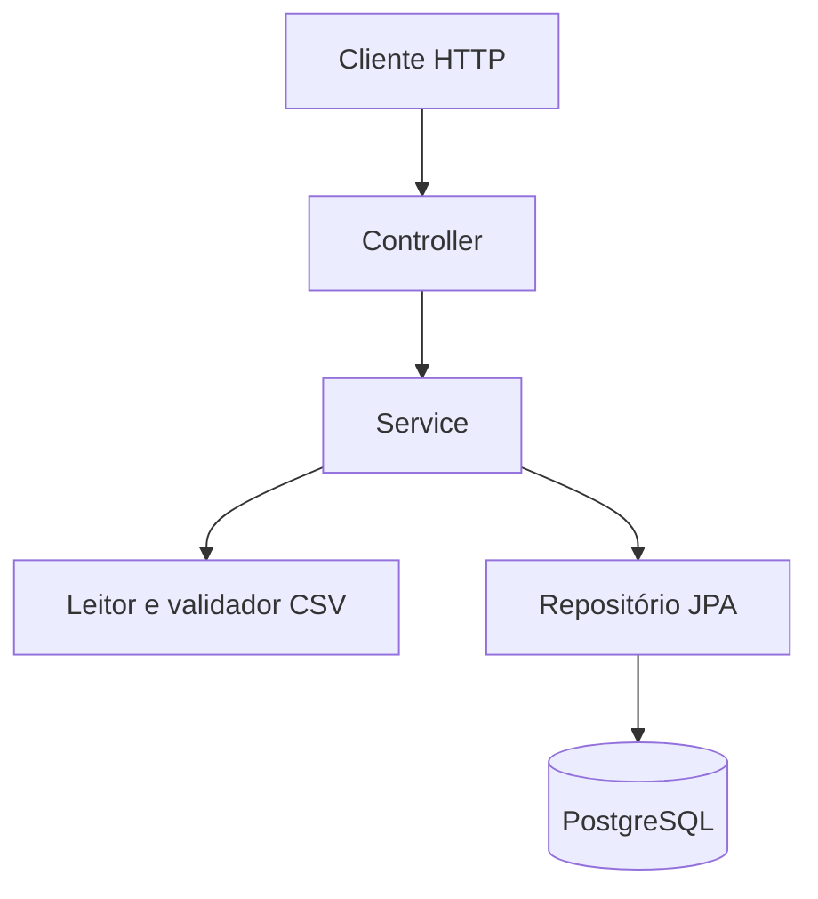

# Menu Carga

[](https://github.com/denzelws/menu-carga/actions/workflows/test.yml)

API REST desenvolvida com Java 17 e Spring Boot 3 para gerenciamento e consulta de concessões de acesso, com suporte à importação de registros em lote via CSV.

O projeto demonstra validação de dados, separação de responsabilidades, persistência relacional, integridade de dados e testes automatizados em diferentes ambientes.

Diário de desenvolvimento: [DIARIO.md](DIARIO.md).

## Funcionalidades

- Cadastro de concessões de acesso.
- Consulta de permissão por pessoa.
- Importação de concessões em lote via CSV.
- Validação dos registros antes da gravação.
- Identificação de erros por linha durante a importação.
- Prevenção de concessões duplicadas.
- Persistência com PostgreSQL e migrações versionadas.
- Testes automatizados e integração contínua.

## Tecnologias

- **Linguagem:** Java 17
- **Backend:** Spring Boot 3
- **API:** REST
- **Persistência:** Spring Data JPA e PostgreSQL 16
- **Migrações:** Flyway
- **Testes:** JUnit 5, Spring Boot Test, MockMvc e Testcontainers
- **Banco para testes rápidos:** H2
- **Infraestrutura:** Docker e Docker Compose
- **CI:** GitHub Actions
- **Build:** Maven

## Como funciona

O sistema gerencia concessões associadas a uma pessoa, um módulo, um caminho de acesso e um direito.

Cada concessão criada nasce ativa. A API permite consultar se uma pessoa possui acesso autorizado ao caminho solicitado.

A importação CSV valida os registros antes de persistir os dados. Linhas inválidas são identificadas individualmente, permitindo que os registros válidos sejam processados sem descartar todo o lote por causa de um erro em uma linha.

### Regras de negócio

- O caminho aceito é `/modulos/menu`.
- O direito aceito é `ACESSO`.
- Toda concessão criada nasce ativa.
- A mesma pessoa não pode receber duas concessões para o mesmo caminho.
- Uma concessão duplicada enviada individualmente resulta em `409 Conflict`.
- Na importação CSV, linhas inválidas são reportadas sem interromper o processamento das demais linhas válidas.
- Arquivos ausentes, vazios ou com cabeçalho inválido são rejeitados.

## Arquitetura

A aplicação utiliza uma arquitetura em camadas, com responsabilidades separadas para o recebimento de requisições HTTP, validação, processamento da importação e persistência.



### Decisões técnicas

- **Separação de responsabilidades:** o controller trata as requisições HTTP, enquanto as regras de negócio ficam no serviço.
- **Validação independente da persistência:** a leitura e a validação do CSV são separadas da gravação dos registros.
- **Flyway:** as alterações no schema são controladas por migrações versionadas.
- **Hibernate:** `ddl-auto=validate` verifica a compatibilidade entre as entidades e o schema existente, sem criar as tabelas automaticamente.
- **Integridade dos dados:** a duplicidade é verificada na aplicação e protegida por um índice único no PostgreSQL.
- **Testes de integração:** o Testcontainers permite executar testes com uma instância isolada do PostgreSQL.

## Contrato da API

### Criar uma concessão

`POST /concessoes`

Exemplo de requisição:

```json
{
"pessoa": "Ana",
"modulo": "Cardapio",
"path": "/modulos/menu",
"direito": "ACESSO"
}
```

Resposta esperada na primeira criação:

`201 Created`

Uma nova tentativa de criar a mesma concessão resulta em:

`409 Conflict`

```json
{
"error": "concessao duplicada"
}
```

### Consultar permissão

`GET /modulos/menu?pessoa=Ana`

Quando existe uma concessão ativa:

```json
{
"permitido": true
}
```

Quando não existe uma concessão ativa:

```json
{
"permitido": false
}
```

Sem `pessoa`, `GET /modulos/menu` responde `200 OK` com corpo vazio. `GET /modules/menu` não existe e responde `404`.

### Importar concessões via CSV

`POST /cargas`

A requisição recebe o arquivo na parte multipart `arquivo`.

O processamento valida o conteúdo e registra os resultados de cada linha. Um arquivo rejeitado retorna `400 Bad Request`; uma importação processada com erros em linhas individuais pode retornar `200 OK`, conforme o contrato implementado.

Exemplo com a Ana válida na linha 2 e a linha 3 sem `pessoa`:

```json
{
"persisted": 1,
"errors": [
{"line": 3, "message": "campo obrigatorio"}
]
}
```

## Testes

O projeto utiliza duas estratégias complementares de testes.

### Testes rápidos

```bash
mvn test
```

Executa os testes utilizando H2, sem exigir Docker.

### Testes de integração

```bash
mvn verify
```

Executa o ciclo de verificação do Maven, incluindo os testes de integração com PostgreSQL por meio do Testcontainers.

Os testes de integração verificam o comportamento da API, a aplicação das migrações do Flyway e a existência da restrição de unicidade no banco.

### Integração contínua

O GitHub Actions executa `mvn verify` em pushes e pull requests, utilizando Java 17 e o Docker disponível no ambiente de execução para os testes com Testcontainers.

## Como executar

### Pré-requisitos

- Java 17
- Maven
- Docker e Docker Compose

### Executar os testes

```bash
mvn test
```

Para executar também os testes de integração com PostgreSQL:

```bash
mvn verify
```

### Iniciar a aplicação com Docker Compose

```bash
docker compose up --build -d
```

A API fica disponível na porta `8080`.

O Compose inicia a aplicação e o PostgreSQL. O volume persistente do banco permite preservar os dados entre reinicializações dos containers.

Para encerrar os serviços:

```bash
docker compose down
```

Esse comando preserva o volume do banco. Para remover também os dados persistidos, seria necessário excluir explicitamente o volume.

Consulte o `docker-compose.yml` para verificar as configurações locais de conexão com o banco.

## Limitações do escopo

Esta versão concentra-se no gerenciamento de concessões e na importação CSV.

Não fazem parte desta entrega:

- Autenticação e autorização com Spring Security ou JWT.
- Cadastro e gerenciamento de usuários.
- Revogação de concessões.
- Importação de arquivos XLSX.
- Versionamento da API em `/v2`.
- Interface frontend.

A API utiliza o parâmetro `pessoa` para identificar a consulta, mas ainda não autentica a identidade de quem realiza a requisição. Portanto, o projeto não deve ser considerado um sistema de controle de acesso pronto para produção.

## Autor

**Denzel Washington Santana Barbosa**

- GitHub: [@denzelws](https://github.com/denzelws)
- Portfólio: [denzelws.vercel.app](https://denzelws.vercel.app/)
