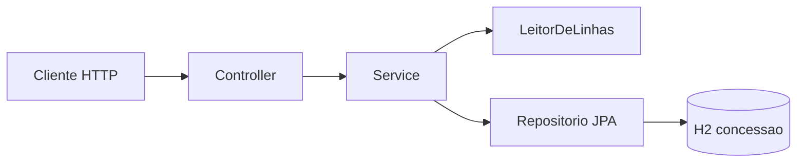

# menu-carga

API em Java 17 e Spring Boot 3 que grava e consulta permissão de acesso a um módulo. Carga em lote por CSV. Consulta por pessoa. H2 nos testes.

**Estado:** etapa 1. O contexto Spring sobe (`ContextoTest`). Concessão, carga e rotas ainda não estão implementadas.

## Objetivo

Gravar uma concessão (`pessoa`, `modulo`, `path`, `direito`) e responder se aquela pessoa tem acesso ativo.

- Path aceito: `/modulos/cardapio`
- Direito aceito: `ACESSO`
- Toda concessão gravada nasce ativa

Na carga CSV, o arquivo inteiro é validado. Só as linhas válidas são gravadas. Uma linha inválida não derruba o lote.

## Arquitetura

O controller não lê arquivo nem decide linha. O service orquestra. O CSV fica atrás de `LeitorDeLinhas`. Quem valida não grava. O repositório não conhece HTTP.



## Critérios de aceite

1. `POST /cargas` com Ana válida e a linha seguinte sem `pessoa`: **200**, grava só Ana, erro na linha 3 com `campo obrigatorio`.
2. Arquivo ausente, vazio ou com cabeçalho diferente: **400** `{ "error": "arquivo rejeitado" }`. Nada persiste.
3. `POST /concessoes` e depois `GET /modulos/cardapio?pessoa=Ana`: `{ "permitido": true }`. Sem concessão: `{ "permitido": false }`.
4. `GET /modulos/cardapio`: **200**. `GET /modules/menu`: **404**.

Os testes passam pela API. Sem seed SQL.

## Executar

```bash
mvn test
```

## Fora desta entrega

XLSX, PostgreSQL, Flyway, Docker, Spring Security, JWT, `/v2`, CRUD de usuário, revogação, seed SQL. O frontend fica em outro repositório.

Diário de desenvolvimento: [DIARIO.md](DIARIO.md).
