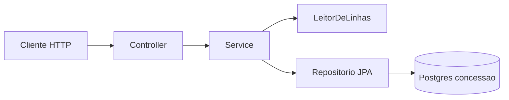

# menu-carga

[](https://github.com/denzelws/menu-carga/actions/workflows/test.yml)

API em Java 17 e Spring Boot 3 que grava e consulta permissão de acesso a um módulo. Carga em lote por CSV. Consulta por pessoa.

A execução usa PostgreSQL 16. O Flyway aplica o schema. Os testes de API ficam no H2. O `mvn verify` sobe um Postgres 16 efêmero com Testcontainers. O GitHub Actions roda esse mesmo `mvn verify`.

**Estado:** API no Compose, migrações V1 e V2 aplicadas, concessão duplicada recusada. O workflow `test` passou no GitHub.

## Objetivo

Gravar uma concessão (`pessoa`, `modulo`, `path`, `direito`) e responder se aquela pessoa tem acesso ativo.

- Path aceito: `/modulos/menu`
- Direito aceito: `ACESSO`
- Toda concessão gravada nasce ativa
- A mesma pessoa não ganha duas concessões para o mesmo path

Na carga CSV, o arquivo inteiro é validado. Só as linhas válidas são gravadas. Uma linha inválida, inclusive a duplicada, não derruba o lote.

## Arquitetura

`menucarga` sobe a aplicação. `menucarga.api.controller` recebe HTTP. `menucarga.api` guarda o JSON. `menucarga.carga` lê e valida o CSV. `menucarga.concessao` grava e consulta. O controller não lê arquivo nem decide linha. O service não conhece o JSON. O CSV fica atrás de `LeitorDeLinhas`. Quem valida não grava. O repositório não conhece HTTP.

O Flyway é o dono do schema: `V1__concessao.sql` cria a tabela e `V2__concessao_pessoa_path_unica.sql` cria o índice `concessao_pessoa_path_uk` em `(pessoa, path)`. O Hibernate, com `ddl-auto=validate`, compara a entidade com esse schema e executa `SELECT` e `INSERT`. A checagem de duplicidade acontece antes do `save`, para a carga devolver o erro da linha sem marcar o lote inteiro para rollback. O índice é a trava no banco.



## Contrato

1. `POST /cargas` com a parte `arquivo`, Ana válida e a linha seguinte sem `pessoa`: **200**, grava só Ana, erro na linha 3 com `campo obrigatorio`.
2. Arquivo ausente, vazio ou com cabeçalho diferente: **400** `{ "error": "arquivo rejeitado" }`. Nada persiste.
3. `POST /concessoes` e depois `GET /modulos/menu?pessoa=Ana`: `{ "permitido": true }`. Sem concessão: `{ "permitido": false }`.
4. `GET /modulos/menu`: **200**. `GET /modules/menu`: **404**.
5. Segundo `POST /concessoes` da mesma pessoa e do mesmo path: **409** `{ "error": "concessao duplicada" }`. Na carga, a linha repetida responde **200**, não grava de novo e devolve `concessao duplicada`.

```bash
curl -sS -D - -X POST http://localhost:8080/concessoes \
  -H 'Content-Type: application/json' \
  -d '{"pessoa":"Ana","modulo":"Cardapio","path":"/modulos/menu","direito":"ACESSO"}'
```

A primeira resposta é **201**, com corpo vazio. A mesma chamada de novo responde **409**:

```json
{"error":"concessao duplicada"}
```

```bash
curl -sS 'http://localhost:8080/modulos/menu?pessoa=Ana'
```

```json
{"permitido":true}
```

Os testes passam pela API. Sem seed SQL. `CargaPostgresIT` repete a carga da Ana num Postgres 16, confere as versões 1 e 2 em `flyway_schema_history` e o índice `concessao_pessoa_path_uk`.

## Executar

```bash
mvn test
mvn verify
docker compose up --build -d
```

`mvn test` fica no H2, com o Flyway desligado, e não exige Docker. `mvn verify` também sobe o Postgres do Testcontainers.

O Compose sobe o Postgres e a API na porta 8080. Credencial local: banco `menu_carga`, usuário `menu`, senha `menu`. Na rede do Compose a API usa o host `postgres`. O `mvn spring-boot:run` nesta máquina continua em `localhost:5432`, no mesmo banco publicado pelo Compose. O volume `menu_carga_pg` guarda a tabela. `docker compose down` sem `-v` preserva esse volume.

O workflow [`.github/workflows/test.yml`](.github/workflows/test.yml) dispara em push e pull request, no `ubuntu-latest`, com Temurin 17 e `mvn -B verify`. Não declara serviço de Postgres: o Docker do runner sobe o container do teste.

## Fora desta entrega

XLSX, Spring Security, JWT, `/v2`, CRUD de usuário, revogação, seed SQL. O frontend fica em outro repositório.

Diário de desenvolvimento: [DIARIO.md](DIARIO.md).
