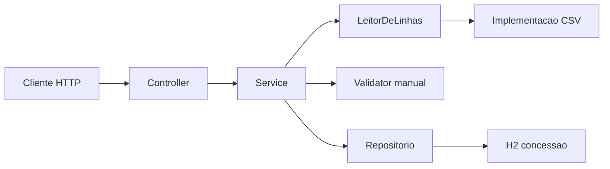

# Guia para o portfólio

Índice curado do laboratório `menu-carga`. A página visual ainda não existe. Este arquivo é a fonte para gerá-la depois: acesso ao projeto e o guia de desenvolvimento realista.

O registro bruto fica em [../DIARIO.md](../DIARIO.md) e em [etapas/](etapas/). Não copie o diário para o `README.md` do projeto.

## Acesso ao projeto

- Repositório local: `/home/dxnzel/dev/menu-carga`
- GitHub: ainda não publicado. O push entra ao fechar a etapa 4.
- Link previsto: `https://github.com/<usuario>/menu-carga`
- Tags previstas, uma por etapa verde: `etapa-1`, `etapa-2`, `etapa-3`, `etapa-4`

Quando o remoto existir, substitua `<usuario>` e use esse link na página do portfólio.

## O que o laboratório é

Um módulo, H2, teste local. A planilha grava concessão de menu: pessoa, módulo, path, direito. A consulta lê essa tabela. O path travado é `/modulos/menu`.

Ordem de construção: esqueleto, concessão, carga, trava do path. Ordem de contagem: carga, consulta, path.

Stack: Java 17, Spring Boot 3, Maven. Artefato `menu-carga`, pacote `menucarga`. CSV lido pela porta `LeitorDeLinhas`. H2 com `ddl-auto=create-drop` nos testes.

Fora desta semana, e portanto fora da página como entregue: XLSX, PostgreSQL, Flyway, Docker, Spring Security, login, JWT, `/v2`, CRUD de usuário, endpoint de revogação, seed em SQL, teste de exceção de banco no meio da transação. A trilha Angular permanece no outro repositório.

## Fronteira



- O controller não lê arquivo nem decide linha.
- O service depende de `LeitorDeLinhas`. A implementação CSV fica atrás dessa porta.
- Quem valida a linha não grava. O repositório não conhece HTTP.
- `@Valid` no corpo de `POST /concessoes`. A linha do CSV vira objeto e o `Validator` roda na mão, dentro do processamento.
- Sem adapter extra por entidade.

## Contrato HTTP

Tabela `concessao`: `id`, `pessoa`, `modulo`, `path`, `direito`, `ativa`. Path aceito: `/modulos/menu`. Direito aceito: `ACESSO`. Toda linha persistida nasce com `ativa = true`.

| Rota | Resultado |
| --- | --- |
| `POST /concessoes` com pessoa, módulo, path e direito válidos | 201 e concessão ativa |
| `POST /concessoes` com corpo inválido | 400 e nada persiste |
| `GET /modulos/menu?pessoa={pessoa}` com concessão ativa | 200 `{ "permitido": true }` |
| `GET /modulos/menu?pessoa={pessoa}` sem concessão | 200 `{ "permitido": false }` |
| `GET /modulos/menu` | 200 |
| `GET /modules/menu` | 404, rota não criada |
| `POST /cargas` com arquivo ausente, vazio ou cabeçalho diferente | 400 `{ "error": "arquivo rejeitado" }` e tabela vazia |
| `POST /cargas` com CSV lido | 200 sempre, mesmo com linha inválida ou `persisted: 0` |

Cabeçalho exato do CSV, linha 1: `pessoa,modulo,path,direito`. A primeira linha de dado é a linha 2. Número de linha é 1-based.

Mensagens de linha: `campo obrigatorio`, `path invalido`, `direito invalido`.

A linha inválida não derruba o lote. O arquivo inteiro é validado. Persistem só as válidas, numa transação, depois da validação. Erro de linha não dá rollback. Arquivo só com cabeçalho: 200, `persisted: 0`, `errors: []`.

## Critério para teste

Cada teste passa pela API. Sem seed SQL. O nome entra na tabela quando a classe nasce.

| Critério | O que prova | Teste | Etapa |
| --- | --- | --- | --- |
| 1 | CSV da Ana grava uma linha e devolve `campo obrigatorio` na linha 3, status 200 | `menucarga.CargaApiTest` | 3 |
| 2 | Arquivo ausente, vazio ou cabeçalho errado devolve 400 `{ "error": "arquivo rejeitado" }` e a tabela fica vazia | `menucarga.CargaApiTest` | 3 |
| 3 | `POST /concessoes` e depois `GET /modulos/menu?pessoa=Ana` devolve permitido true; sem concessão, false | `menucarga.ConcessaoApiTest` | 2 |
| 4 | `GET /modulos/menu` devolve 200 e `GET /modules/menu` devolve 404 | `menucarga.ConcessaoApiTest` | 4 |
| Contexto | O contexto Spring sobe | `menucarga.ContextoTest` | 1 |

Fixture do critério 1:

```csv
pessoa,modulo,path,direito
Ana,Cardapio,/modulos/menu,ACESSO
,Cardapio,/modulos/menu,ACESSO
```

## Evidências

Nenhuma captura foi feita. Os arquivos abaixo são o nome esperado, não um arquivo presente.

- `docs/evidencias/etapa-01-contexto-verde.txt` — saída do teste que sobe o contexto
- `docs/evidencias/etapa-02-criterio-3.txt` — POST concessão e os dois GETs
- `docs/evidencias/etapa-03-criterio-1.txt` — carga da fixture da Ana
- `docs/evidencias/etapa-03-criterio-2.txt` — arquivo rejeitado e tabela vazia
- `docs/evidencias/etapa-04-criterio-4.txt` — 200 no path travado e 404 em `/modules/menu`

Tempo real e CAR continuam no diário e em `docs/etapas/`, não nestes arquivos.

## Página visual, depois

Quando for separar isto numa doc de portfólio:

1. Link do GitHub e das tags `etapa-1` a `etapa-4`.
2. O diagrama de fronteira e a tabela de contrato, copiados daqui.
3. Uma entrada por etapa, puxada de `docs/etapas/`: tempo real, erro real, tradeoff, solução, CAR.
4. As evidências de teste verde, quando existirem.
5. A frase do README: a linha inválida não derruba o lote, com ponteiro para os testes.

Não tratar como entregue o que esta página ainda marca como não executado.
