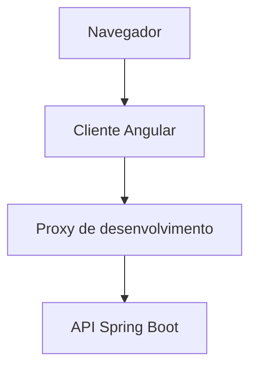

# Menu Carga — Frontend

Cliente Angular das três operações da API Menu Carga: consulta de permissão, cadastro de concessão e importação de CSV.

O cliente consome o contrato HTTP já implementado. Ele não altera o Java, não autentica o usuário e não inventa rotas.

Documentação da API: [README.md](../README.md).

## Funcionalidades

- Consulta de permissão por pessoa, com os retornos `permitido: true`, `permitido: false` e corpo vazio.
- Cadastro manual de uma concessão ativa.
- Exibição do `409` quando a mesma pessoa já possui concessão naquele caminho.
- Importação de concessões em lote via CSV.
- Download de um modelo que contém apenas o cabeçalho.
- Resumo das linhas gravadas e tabela dos erros por linha.
- Manutenção do arquivo escolhido ao trocar de tela, com opção de removê-lo.

## Tecnologias

- **Framework:** Angular 21.2.26
- **CLI:** Angular CLI 21.2.29
- **Linguagem:** TypeScript 5.9.3
- **Estilo:** Tailwind CSS 4.3.4
- **Testes unitários:** Vitest
- **Testes de ponta a ponta:** Playwright 1.64.1
- **Node:** 24, com npm 11.17.0
- **Servidor de desenvolvimento:** `ng serve` com proxy para a API

As versões acima são as resolvidas no `package-lock.json`. O `package.json` declara faixas.

## Como funciona

O navegador fala com o Angular em `http://localhost:4200/`. As chamadas saem com o prefixo `/api`. O `proxy.conf.js` remove esse prefixo e encaminha a requisição ao Spring Boot em `http://localhost:8080`.

```text
/api/modulos/menu  ->  http://localhost:8080/modulos/menu
/api/concessoes    ->  http://localhost:8080/concessoes
/api/cargas        ->  http://localhost:8080/cargas
```

O proxy existe só no servidor de desenvolvimento. O `npm run build` não o inclui.

### Telas

- **Consultar Permissão.** Chama `GET /modulos/menu`. Com uma pessoa, mostra se o acesso está permitido. Sem pessoa, a API responde `200` com corpo vazio, e a tela mostra esse estado.
- **Concessão Manual.** Chama `POST /concessoes`. Pessoa e módulo são editáveis. O caminho permanece `/modulos/menu` e o direito permanece `ACESSO`. A primeira gravação mostra o `201`. Repetir a mesma pessoa mostra "Concessão duplicada".
- **Importação CSV.** Chama `POST /cargas` com a parte multipart `arquivo`. O modelo traz só o cabeçalho `pessoa,modulo,path,direito`. Um lote aceito responde `200`, com a quantidade gravada e os erros por linha. Arquivo ausente, vazio ou com cabeçalho diferente responde `400`, e a tela mostra "Arquivo rejeitado".

## Arquitetura

O cliente fica isolado em `frontend/`. Cada tela chama um serviço HTTP. A regra de negócio continua na API.



### Decisões técnicas

- **Sem alteração no backend:** a falta de CORS é contornada pelo proxy de desenvolvimento, sem mudar o Java.
- **Proxy em JavaScript:** `proxy.conf.js` usa uma função em `rewrite`. O builder Vite deste Angular não garante `pathRewrite` em JSON.
- **Contrato preservado:** os campos continuam `pessoa`, `modulo`, `path` e `direito`. O cliente não traduz esses nomes.
- **Estado local:** a escolha do CSV fica em memória para sobreviver à troca de rota. Ela não é gravada no navegador.
- **Teste de ponta a ponta sem mock:** o Playwright usa a API real. Cada execução grava pessoas novas.

## Testes

O cliente utiliza duas estratégias complementares de testes. Vitest e Playwright continuam locais. O GitHub Actions executa `npm ci` e `npm run build`, e um push na `main` publica o resultado no site.

### Testes unitários

```bash
npm test
```

Executa os testes com Vitest, sem exigir a API nem o Docker.

### Testes de ponta a ponta

Na primeira vez, instale o navegador usado pelo Playwright:

```bash
npx playwright install chromium
```

Com a API disponível na porta `8080`:

```bash
npm run e2e
```

O fluxo grava duas pessoas por execução, `E2E-CAD-<timestamp>` e `E2E-CSV-<timestamp>`. Não há endpoint para apagá-las. Esse fluxo roda no projeto desktop. O projeto mobile verifica se as três telas cabem na largura do celular. Os dois testes ignorados são essa divisão: cada projeto pula o teste do outro.

## Como executar

### Pré-requisitos

- Node 24 (`nvm use 24`)
- npm 11.17.0
- A API no ar na porta `8080`

Na raiz do repositório, a API sobe com:

```bash
docker compose up --build -d
```

### Iniciar o cliente

```bash
cd frontend
npm install
npm start
```

O cliente fica disponível em `http://localhost:4200/`.

O `ng` não precisa estar no `PATH`. Os scripts usam o binário local.

### Build

```bash
npm run build
```

Os artefatos ficam em `dist/`. Esse build não configura o endereço da API em produção.

## Limitações do escopo

Esta versão cobre a consulta, o cadastro manual e a importação CSV.

Não fazem parte desta entrega:

- Listagem de concessões. A API não oferece `GET /concessoes`.
- Autenticação de quem usa a tela.
- Revogação ou edição de uma concessão já gravada.
- Publicação do cliente.

Depois de gravar, a forma de conferir uma pessoa é a consulta por nome.

## Autor

**Denzel Washington Santana Barbosa**

- GitHub: [@denzelws](https://github.com/denzelws)
- Portfólio: [denzelws.vercel.app](https://denzelws.vercel.app/)
